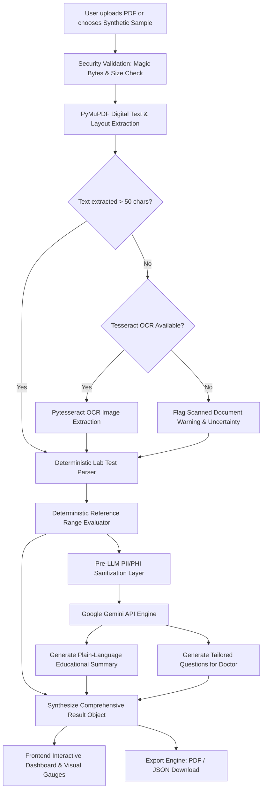

# MediLens AI — Architecture & System Specification

## 1. System Mission & Clinical Boundary
MediLens AI is an informational web application designed to help individuals understand routine laboratory reports in clear, accessible language.
- **Strict Non-Diagnostic Principle**: MediLens AI is an educational communication aid, **not** a clinical diagnostic, prognostic, or treatment-prescribing system.
- **Zero Hallucination Guarantee for Clinical Data**: All extracted test names, numerical values, units, reference intervals, and out-of-range classifications are performed strictly by **deterministic algorithms** (regex parsing and numeric comparison).
- **No Inferred Critical Status**: Results are never labeled as CRITICAL unless a validated, source-supported panic-value threshold is available. Otherwise, values are classified strictly against the laboratory's stated reference interval (`NORMAL`, `LOW`, `HIGH`, `INCONCLUSIVE`).
- **Separation of Educational Content & Generative AI**:
  - Deterministic Educational Knowledge Base provides static biological context for known analytes with explicitly labeled sources.
  - Generative AI (Google Gemini via `google-genai` SDK) is used exclusively for conversational synthesis, uncertainty clarification, and doctor questions.
  - If Gemini is unconfigured or fails, the system explicitly returns `AIExplanationStatus.AI_UNAVAILABLE` rather than fabricating or silently substituting text.
- **Privacy by Design & Ephemeral Processing**: Uploaded PDF files are processed entirely in memory; raw files and extracted full text are not persisted by default. Logging is strictly privacy-safe with automated redaction filters.
- **Runtime Environment**: Python 3.13.13 (64-bit) with Node.js v26.4.0.

---

## 2. Directory Structure Proposal

```
medilens-ai/
├── backend/
│   ├── app/
│   │   ├── __init__.py
│   │   ├── main.py                  # FastAPI entry point, CORS, exception handlers
│   │   ├── config.py                # Pydantic BaseSettings, env vars
│   │   ├── api/
│   │   │   ├── __init__.py
│   │   │   ├── deps.py              # Dependency injection for services
│   │   │   └── routes/
│   │   │       ├── __init__.py
│   │   │       ├── reports.py       # Upload, parse, process, export endpoints
│   │   │       ├── history.py       # History list, get by ID, delete
│   │   │       └── health.py        # Healthcheck (Gemini, OCR, PyMuPDF status)
│   │   ├── core/
│   │   │   ├── __init__.py
│   │   │   ├── security.py          # PDF magic-byte validation, file size limits
│   │   │   └── privacy.py           # PII/PHI redaction engine (scrub name, MRN, etc.)
│   │   ├── models/
│   │   │   ├── __init__.py
│   │   │   ├── report.py            # Pydantic schemas (TestResult, ReportSummary, etc.)
│   │   │   └── responses.py         # Standardized API response envelopes
│   │   ├── services/
│   │   │   ├── __init__.py
│   │   │   ├── pdf_extractor.py     # PyMuPDF digital text & structure extraction
│   │   │   ├── ocr_service.py       # Tesseract OCR fallback for scanned/image pages
│   │   │   ├── parser.py            # Deterministic lab panel tabular/regex parser
│   │   │   ├── reference_ranges.py  # Deterministic reference-range numeric evaluator
│   │   │   ├── gemini_service.py    # Google Gemini client (explanations & questions)
│   │   │   └── export_service.py    # PDF and JSON export generation
│   │   └── utils/
│   │       ├── __init__.py
│   │       └── logger.py            # Privacy-safe logging (no sensitive health contents)
│   ├── sample_reports/              # Synthetic test PDFs (CBC, CMP, Lipid panel)
│   ├── tests/
│   │   ├── __init__.py
│   │   ├── test_pdf_extractor.py
│   │   ├── test_parser.py
│   │   ├── test_reference_ranges.py
│   │   ├── test_gemini_service.py
│   │   └── test_api.py
│   ├── requirements.txt
│   └── pytest.ini
├── frontend/
│   ├── public/
│   │   └── favicon.svg
│   ├── src/
│   │   ├── assets/
│   │   ├── components/
│   │   │   ├── layout/              # Navbar, Sidebar/Breadcrumbs, Footer, Disclaimer
│   │   │   ├── common/              # Badge, Button, Modal, Tooltip, AlertBanner
│   │   │   ├── dashboard/           # MetricsCards, RecentAnalyses, QuickUploadCTA
│   │   │   ├── upload/              # Dropzone, FileValidationCard, ProcessingFeedback
│   │   │   ├── results/             # SummaryCard, ResultsTable, VisualRangeBar,
│   │   │   │                        # QuestionsForDoctor, UncertaintyAlert
│   │   │   └── history/             # HistoryTable, SearchFilter, ActionMenu
│   │   ├── pages/
│   │   │   ├── DashboardPage.tsx
│   │   │   ├── UploadPage.tsx
│   │   │   ├── ResultsPage.tsx
│   │   │   ├── HistoryPage.tsx
│   │   │   └── PrivacySettingsPage.tsx
│   │   ├── services/
│   │   │   ├── api.ts               # Axios/fetch typed API client
│   │   │   └── mockData.ts          # Verified synthetic reports for instant demo
│   │   ├── types/
│   │   │   └── report.ts            # TypeScript interfaces synchronized with Pydantic
│   │   ├── utils/                   # Formatting, date helpers, status color tokens
│   │   ├── App.tsx
│   │   ├── main.tsx
│   │   └── index.css                # Tailwind CSS + custom healthcare design tokens
│   ├── package.json
│   ├── vite.config.ts
│   ├── tsconfig.json
│   └── tailwind.config.js
├── docs/
│   ├── ARCHITECTURE.md
│   ├── PROMPT_LOG.md
│   └── VIDEO_PRESENTATION.md
├── .env.example
├── .gitignore
└── README.md
```

---

## 3. Frontend & Backend Architecture

### Backend Architecture (FastAPI + Pydantic)
- **Framework**: FastAPI (Python 3.13) providing native asynchronous handling and high-throughput concurrent request execution.
- **Validation & Schemas**: Pydantic v2 defines strict data contracts (`TestResult`, `ReportSummary`, `ReportListItem`, `ReportListResponse`).
- **Layered Decoupling**:
  1. *Router Layer*: HTTP handling, multipart file intake, input validation, status codes under `/api/v1`.
  2. *Security & Privacy Layer*: Binary file inspection (magic bytes `%PDF-`), MIME verification, and pre-LLM PII/PHI scrubbing before data enters analytics.
  3. *Deterministic Extraction Layer*: PyMuPDF-based text and table bounding, followed by regex tokenizers targeting standard panel formats (CBC, CMP, Lipid, Glucose). Numerical bounds checks against extracted reference intervals classify each test as `NORMAL`, `LOW`, `HIGH`, `CRITICAL_LOW`, `CRITICAL_HIGH`, or `INCONCLUSIVE`.
  4. *AI Generation Layer*: Google Gemini API connector (`gemini-2.5-flash`) using structured prompts with temperature controls (`0.2`) to prevent hallucination, generating educational summaries and doctor questions.
  5. *Storage & Lifecycle*: Zero raw PDF persistence. Ephemeral in-memory handling for uploads. Processed summaries stored in a local lightweight SQLite repository (`backend/app/services/storage.py`) with parameterized queries, toggleable persistence, and complete user-managed deletion controls.
  6. *Export Engine*: ReportLab-based PDF generation and structured JSON export with mandatory disclaimers, deterministic test tables, and conditional AI sections.

### Frontend Architecture (React 19 + Vite 8 + TypeScript + Tailwind CSS)
- **Framework & Tooling**: Vite 8 with React 19 and TypeScript (`strict: true`). Fast HMR and sub-2s production bundle builds.
- **Component Architecture**:
  - `components/layout/`: `Layout`, `Navbar` (live backend health indicator pill), `Sidebar` (responsive desktop & mobile drawer), `DisclaimerBanner` (permanent non-diagnostic clinical disclaimer).
  - `components/common/`: `StatusBadge` (accessible icons + text for all deterministic flags), `SyntheticBadge`, `AIStatusBadge`, `Button` (with loading spinner & variants), `Modal` (accessible dialog with focus trap & keyboard listeners), `Alert`, `LoadingSpinner`.
  - `components/results/`: `ResultsTable` (searchable/filterable clinical table), `RangeVisualizer` (two-sided horizontal visual reference gauges with pin markers), `AIExplanationCard` (plain-language summary with explicit offline fallback state), `DoctorQuestionsCard` (discussion topics with one-click clipboard copy), `EducationalNotesCard` (deterministic biological reference guide).
- **Page Structure**:
  - `DashboardPage` (`/`): Real-time metrics (actual reports, analytes, in-range, flagged), recent reports list, Recharts distribution visualization, synthetic sample launcher modal.
  - `UploadPage` (`/upload`): Drag-and-drop zone, PDF-only validation, 10MB limit enforcement, step-by-step processing tracker, synthetic demo buttons, privacy policy callout.
  - `ReportResultsPage` (`/reports/:reportId`): Full findings display, deterministic badges, uncertainty alerts, AI narrative, doctor questions, PDF export, JSON export, permanent deletion modal.
  - `ReportHistoryPage` (`/history`): Paginated history table, real-time search, quick PDF/JSON downloads, deletion confirmation, empty state with upload action.
  - `PrivacySettingsPage` (`/settings`): Live runtime audit of FastAPI backend, Gemini SDK configuration, and SQLite storage status; explicit transparency disclosures on PII scrubbing, anonymity limits, and single-user storage.
  - `NotFoundPage` (`*`): Safe 404 fallback with return to dashboard.
- **API Integration Client**:
  - Centralized Axios client (`frontend/src/services/api.ts`) configured via `VITE_API_BASE_URL` (defaults to `http://127.0.0.1:8000`).
  - Strict mapping to backend Pydantic models with robust error parsing (`ApiError`).
  - Dynamic binary blob file download trigger for clinical PDF and JSON exports.
- **Visual Design System**:
  - Deep Navy typography (`#0f172a`, `#1e293b`), Clinical Teal/Brand accents (`#0d9488`, `#0f766e`), Soft off-white backgrounds (`#f8fafc`).
  - High-contrast accessible badges communicating status through explicit icons and text (never color alone).

---

## 4. REST API Endpoints & Contract Specification

All endpoints are hosted under the `/api/v1` prefix.

| Method | Endpoint | Description | Request Payload / Params | Response |
| :--- | :--- | :--- | :--- | :--- |
| `GET` | `/api/v1/health` | System health check (PyMuPDF, OCR availability, Gemini configuration) | None | `{ "status": "healthy", "ocr_status": { ... }, "gemini_status": { ... } }` |
| `POST` | `/api/v1/reports/upload` | Upload PDF lab report, parse deterministically, run AI explanation, persist summary | `multipart/form-data` (`file`: PDF) | `ReportSummary` (200 OK) |
| `POST` | `/api/v1/reports/sample` | Load a verified synthetic demonstration report (CBC, CMP, Lipid, Glucose) | JSON: `{ "sample_type": "cbc" \| "cmp" \| "glucose" \| "lipid" }` | `ReportSummary` (200 OK) |
| `GET` | `/api/v1/reports` | List historical analyzed reports with pagination and search | Query params: `page` (int, ge=1), `limit` (int, 1-100), `search` (str, optional) | `ReportListResponse` (200 OK) |
| `GET` | `/api/v1/reports/{report_id}` | Retrieve full structured findings and AI explanation by report ID | Path param: `report_id` (str) | `ReportSummary` (200 OK) / 404 Not Found |
| `DELETE` | `/api/v1/reports/{report_id}` | Permanently delete report and all findings from storage | Path param: `report_id` (str) | `204 No Content` / 404 Not Found |
| `GET` | `/api/v1/reports/{report_id}/export` | Export structured report as clinical-grade PDF or JSON | Path param: `report_id`, Query param: `format=pdf\|json` | File download (`application/pdf` or `application/json`) / 404 Not Found |

### API Response Contracts (Frontend Integration Reference)

#### 1. `ReportSummary` (Upload, Sample, and Detail Endpoint)
```json
{
  "id": "rep-7f094d8b-85c7-411a-a936-71144e2d1401",
  "filename": "synthetic_cbc_panel.pdf",
  "upload_timestamp": "2026-10-27T10:30:00Z",
  "metadata": {
    "page_count": 1,
    "extracted_character_count": 450,
    "is_scanned": false,
    "ocr_applied": false,
    "ocr_available": false,
    "is_synthetic": true
  },
  "tests": [
    {
      "name": "Hemoglobin",
      "canonical_name": "Hemoglobin",
      "category": "Complete Blood Count",
      "value_text": "14.5",
      "value_numeric": 14.5,
      "unit": "g/dL",
      "reference_interval": {
        "raw_text": "13.5 - 17.5",
        "low": 13.5,
        "high": 17.5,
        "is_numeric": true
      },
      "flag": "NORMAL",
      "source_page": 1,
      "uncertainty_notes": []
    }
  ],
  "educational_notes": [
    {
      "analyte_name": "Hemoglobin",
      "category": "Complete Blood Count",
      "plain_language_role": "Hemoglobin is an iron-rich protein in red blood cells that carries oxygen from your lungs to the rest of your body.",
      "general_context": "Laboratory reference intervals for hemoglobin typically vary based on age, biological sex, and altitude.",
      "clinical_source": "American Association for Clinical Chemistry (AACC) / MedlinePlus"
    }
  ],
  "ai_explanation": {
    "status": "completed",
    "status_reason": null,
    "provider": "Google Gemini",
    "summary_text": "Your hemoglobin is within normal healthy reference limits.",
    "questions_for_doctor": [
      "Are my complete blood count trends consistent with previous annual lab checks?"
    ]
  },
  "total_tests_detected": 1,
  "in_range_count": 1,
  "out_of_range_count": 0,
  "inconclusive_count": 0,
  "is_synthetic": true
}
```

#### 2. `ReportListResponse` (Dashboard History Table)
```json
{
  "items": [
    {
      "id": "rep-7f094d8b-85c7-411a-a936-71144e2d1401",
      "filename": "synthetic_cbc_panel.pdf",
      "upload_timestamp": "2026-10-27T10:30:00Z",
      "total_tests_detected": 5,
      "in_range_count": 5,
      "out_of_range_count": 0,
      "inconclusive_count": 0,
      "is_synthetic": true,
      "ai_status": "completed"
    }
  ],
  "total": 1,
  "page": 1,
  "limit": 10,
  "has_more": false,
  "history_enabled": true
}
```

---

## 5. Storage Architecture & Privacy Lifecycle

### Privacy-Aware SQLite Storage (`StorageRepository`)
MediLens AI implements a localized, privacy-aware SQLite persistence repository:
1. **Zero Raw PDF Persistence**: Raw uploaded PDF byte streams are processed exclusively in RAM and discarded immediately after parsing. They are never written to disk or the SQLite database.
2. **Zero Full-Text or Raw Prompt Persistence**: Unrestricted OCR text, extracted source strings with potential PII, and full LLM prompts are excluded from persistence.
3. **Structured Data Only**: The database stores only validated, structured Pydantic objects (`ReportSummary`), aggregate counters, metadata, and timestamps.
4. **Configuration Controls**:
   - `ENABLE_HISTORY_PERSISTENCE`: Boolean setting (`True` by default). When set to `False`, the application functions entirely ephemerally; report upload, parsing, and export continue working in-memory, but no record is written to disk.
   - `SQLITE_DB_PATH`: Configurable database filepath (default: `medilens_history.db`).
5. **Database Schema (`reports` table)**:
   - `id TEXT PRIMARY KEY`: Canonical report identifier (e.g. `rep-<uuid>`).
   - `filename TEXT NOT NULL`: Sanitized filename for display.
   - `upload_timestamp TEXT NOT NULL`: ISO-8601 creation timestamp.
   - `total_tests INTEGER NOT NULL`: Total laboratory tests extracted.
   - `in_range_count INTEGER NOT NULL`, `out_of_range_count INTEGER NOT NULL`, `inconclusive_count INTEGER NOT NULL`: Aggregate clinical metrics.
   - `is_synthetic INTEGER NOT NULL`: Flag (1/0) indicating whether data is synthetic or user-supplied.
   - `ai_status TEXT NOT NULL`: Status of AI explanation (`completed`, `ai_unavailable`, `failed`, `sanitization_blocked`).
   - `structured_json TEXT NOT NULL`: Clean JSON serialization of `ReportSummary`.
   - `created_at TEXT DEFAULT CURRENT_TIMESTAMP`.
   - Indexes on `upload_timestamp DESC` and `filename` for optimized search and pagination.
6. **Deletion Lifecycle**:
   - `DELETE /api/v1/reports/{report_id}` permanently removes the database row via parameterized query (`DELETE FROM reports WHERE id = ?`).
   - Subsequent `GET` and export requests for that ID immediately return `404 Not Found`.
7. **Security & Deployment Boundaries**:
   - Uses parameterized SQL statements exclusively, eliminating SQL injection risks.
   - Local SQLite database file does not implement column-level encryption or multi-user access control. In a multi-tenant or public deployment, a managed database with Row-Level Security (RLS) and encryption-at-rest must be introduced.

---

## 6. PDF & JSON Export Engine

The export engine (`ExportService`) produces clinical-grade, non-diagnostic documents:
1. **Engine**: Built with ReportLab using standard Flowable layout primitives (paragraphs, spacers, tables, rule lines).
2. **Key Elements**:
   - **Header**: Branded "MediLens AI — Laboratory Report Summary" with unique Report ID and generation timestamp.
   - **Informational Disclaimer**: Prominent header callout declaring that the document is for informational educational purposes only and is not a clinical diagnosis.
   - **Synthetic Indicator**: Clear banner stating when the document was generated from synthetic demonstration data.
   - **Laboratory Test Findings Table**: Clean tabular layout displaying Canonical Analyte Name, Extracted Value, Units, Laboratory Reference Interval, and Deterministic Flag Status (`NORMAL`, `LOW`, `HIGH`, etc.).
   - **Uncertainty & Notes**: Extraction warnings or reference interval ambiguities explicitly printed alongside results.
   - **AI-Generated Explanations**: Included **only** when `ai_explanation.status == "completed"`. If Gemini was offline or unconfigured, the document explicitly prints `"AI Summary Status: Unavailable"` and explains that deterministic results remain fully valid, avoiding fabricated prose.
   - **Doctor Discussion Guide**: Formatted bulleted questions to support informed patient-physician conversations.
3. **JSON Export**: Formatted, indented JSON export (`format=json`) providing a machine-readable representation of the exact `ReportSummary` schema.

---

## 5. Document-Processing & AI Workflow



### Detailed Workflow Stages:
1. **Intake & Validation**: Rejects non-PDFs, password-protected files, or files > 10MB before disk write. Processing occurs entirely in-memory (`pymupdf.open(stream=pdf_bytes, filetype="pdf")`).
2. **PyMuPDF Extraction**: Extracts text blocks, lines, font weights, and coordinate bounds to maintain row-level association across Test Name, Result Value, Units, and Reference Intervals.
3. **OCR Fallback**: If a page is purely rasterized or scanned, checks for local Tesseract OCR engine. If missing, reports a transparent uncertainty note to the user instead of failing silently.
4. **Deterministic Parser**: Extracts known lab tests using validated regular expressions covering Common Blood Count (CBC), Comprehensive Metabolic Panel (CMP), Lipid Panels, and Thyroid Panels.
5. **Deterministic Flagging**: Values are parsed into numeric floats/integers and checked against numeric upper and lower bounds. Values are tagged `NORMAL`, `LOW`, `HIGH`, or `INCONCLUSIVE` (CRITICAL reserved solely for validated source-supported panic thresholds).
6. **Dedicated Privacy Sanitization Layer (`privacy_sanitizer.py`)**:
   - Strips patient names, DOBs, MRNs, phone numbers, email addresses, and postal addresses.
   - Neutralizes adversarial prompt-injection attempts embedded in document text.
   - Constructs a strictly minimized, allowlisted payload from `TestResult` objects containing only canonical test names, values, units, reference intervals, and deterministic flags. Raw PDF text is never forwarded.
   - If an analyte cannot be safely sanitized, it is omitted. If the entire payload is compromised, the AI call is blocked with an explicit status.
7. **Gemini AI Explanation Service (`gemini_service.py`)**:
   - Uses the official `google-genai` SDK targeting `gemini-2.5-flash`.
   - Temperature configured to `0.2` for factual, grounded educational explanations.
   - Configured with request timeouts (30s) and bounded retries (max 2) on transient network or 429/503 errors.
   - Uses structured JSON output enforced via Pydantic (`GeminiStructuredResponse`).
   - If unconfigured, timed out, or failing, returns an explicit `AIExplanationStatus.AI_UNAVAILABLE` with a clear reason, never inventing or substituting fake prose.
8. **Deterministic & AI Separation**:
   - Extracted lab numbers and deterministic flags are returned intact regardless of AI status.
   - Educational content from the static knowledge base is kept separate from AI explanations.
9. **Export**: ReportLab compiles an accessible summary PDF retaining all disclaimers.


---

## 6. Dependencies, Environment Variables, Privacy Risks & Testing

### Dependencies
- **Backend**:
  - `fastapi`, `uvicorn[standard]`
  - `pydantic`, `pydantic-settings`
  - `pymupdf` (fitz)
  - `pytesseract`, `pillow`
  - `google-genai` (official Google Gemini SDK)
  - `python-multipart`
  - `reportlab` (deterministic PDF report generation)
  - `pytest`, `pytest-asyncio`, `httpx`
- **Frontend**:
  - `react`, `react-dom`
  - `vite`, `@vitejs/plugin-react`
  - `typescript`
  - `tailwindcss`, `postcss`, `autoprefixer`
  - `lucide-react`
  - `recharts`
  - `axios`

### Environment Variables (`backend/.env`)
- `GEMINI_API_KEY`: API key for Google Gemini model access.
- `GEMINI_MODEL`: Model identifier (default: `gemini-1.5-flash`).
- `TESSERACT_CMD`: Path to tesseract executable if installed in non-standard location.
- `MAX_UPLOAD_SIZE_MB`: Maximum file size permitted (default: `10`).
- `ENVIRONMENT`: `development` | `production`.
- `ENABLE_DEMO_MODE`: `true` (enables synthetic sample loading).

### Privacy & Security Risks and Mitigations
- **Sensitive Health Data Exposure**: Raw lab reports contain patient identities. *Mitigation*: Ephemeral file handling (no permanent raw PDF disk storage), pre-LLM PII/PHI scrubbing, no patient data written to console/application logs.
- **Diagnostic Misinterpretation**: Users may take AI output as medical advice. *Mitigation*: Prominent non-diagnostic banners on every page, non-prescriptive AI prompt guardrails, and generation of questions specifically designed to foster doctor-patient dialogue.
- **Malicious File Injection**: Attackers uploading poisoned PDFs. *Mitigation*: Binary header inspection, strict MIME type validation, isolated parsing in PyMuPDF with exception boundaries.

### Testing Requirements
- **Unit Tests**:
  - `test_pdf_extractor.py`: Verify PyMuPDF extracts text, page count, and handles empty/corrupt files cleanly.
  - `test_parser.py`: Verify deterministic extraction on synthetic CBC, CMP, and Lipid reports with exact string and numeric matching.
  - `test_reference_ranges.py`: Verify bounds evaluations (e.g., `<100`, `135 - 145`, edge cases, unit mismatches).
  - `test_privacy.py`: Verify patient identifiers are completely stripped prior to payload construction.
  - `test_gemini_service.py`: Verify Gemini prompt construction, response parsing, and graceful fallback when offline/unconfigured.
- **Integration Tests**:
  - `test_api.py`: Test `/upload`, `/sample`, `/health`, and `/export` endpoints using FastAPI TestClient (`httpx`).
- **Frontend Verification**:
  - TypeScript strict compilation check (`tsc --noEmit`).
  - Production build verification (`npm run build`).

---

## 7. Phased Implementation Plan

1. **Phase 1: Architecture, Scaffolding & Documentation Baseline** *(Current Phase)*
   - Inspect workspace and tools.
   - Establish directory layout and architectural blueprints.
   - Initialize prompt log and presentation materials.
2. **Phase 2: Backend Core & Deterministic Processing Engine**
   - Create Python environment and install backend dependencies.
   - Build `pdf_extractor.py`, `ocr_service.py`, `parser.py`, and `reference_ranges.py`.
   - Create synthetic sample laboratory reports (CBC, CMP, Lipid panel).
   - Implement unit tests verifying deterministic extraction and numerical bounds flagging.
3. **Phase 3: Gemini AI Integration & Privacy Guardrails**
   - Implement PII/PHI redaction layer in `core/privacy.py`.
   - Build `gemini_service.py` with structured prompts, temperature controls, and offline fallback mechanisms.
   - Verify non-diagnostic prompt compliance with unit tests.
4. **Phase 4: FastAPI REST Endpoints & Export Engine**
   - Implement API routes (`reports.py`, `history.py`, `health.py`).
   - Implement PDF/JSON export generation using ReportLab.
   - Implement API integration tests with `pytest`.
5. **Phase 5: Frontend Design System & Scaffolding**
   - Initialize Vite + React + TypeScript in `frontend/`.
   - Configure Tailwind CSS with healthcare color palette, typography, and glassmorphic UI tokens.
   - Build layout primitives (Navbar, Disclaimer Banner, Metric Cards).
6. **Phase 6: Five Core Application Pages & Interactive Workflows**
   - **Dashboard**: Metric counters, quick action CTA, recent reports list.
   - **Upload Page**: Drag-and-drop zone, file validation card, live processing step tracker, and synthetic sample selector.
   - **Results Page**: Plain-language AI summary, extracted lab tests table, visual Recharts reference range gauges, source page annotations, uncertainty notices, and doctor question cards.
   - **History Page**: Searchable/filterable historical analyses, view, export, and delete actions.
   - **Privacy & Settings Page**: Transparent data handling explanations, external AI disclosures, retention controls, and system status indicators.
7. **Phase 7: End-to-End Verification & Final Deliverables**
   - Run end-to-end user workflows using browser automation/subagent.
   - Finalize `docs/PROMPT_LOG.md` with prompt records, test logs, and outcomes.
   - Finalize `docs/VIDEO_PRESENTATION.md` with demonstration script and architecture retrospective.

---

## 8. Local Run Instructions (Windows PowerShell)

### Prerequisites
- **Python 3.13** installed with active virtual environment in `backend/venv`.
- **Node.js v20+** (tested with v26.4.0) and **npm v11+**.
- Google Gemini API Key (optional; defaults cleanly to `ai_unavailable` with 100% working deterministic analysis if omitted).

### Terminal 1: Start FastAPI Backend
```powershell
# Navigate to repository root
cd c:\Users\happy\Downloads\medilens-ai

# Activate backend Python virtual environment
.\backend\venv\Scripts\Activate.ps1

# (Optional) Configure environment variables
# Copy backend/.env.example to backend/.env if not present

# Launch FastAPI dev server with auto-reload
uvicorn backend.app.main:app --reload --host 127.0.0.1 --port 8000
```
Backend is live at `http://127.0.0.1:8000` (API documentation at `http://127.0.0.1:8000/docs`).

### Terminal 2: Start React Frontend
```powershell
# Navigate to frontend directory
cd c:\Users\happy\Downloads\medilens-ai\frontend

# Install dependencies (if not already installed)
npm install

# Launch Vite development server
npm run dev
```
Frontend dashboard is accessible in your browser at `http://localhost:5173`.

### Automated Verification Commands
```powershell
# Run backend pytest suite (59 tests)
.\backend\venv\Scripts\pytest .\backend\tests -v

# Run frontend Vitest suite (19 tests)
cd frontend; npm run test

# Run frontend TypeScript & Vite production build check
cd frontend; npm run build
```

